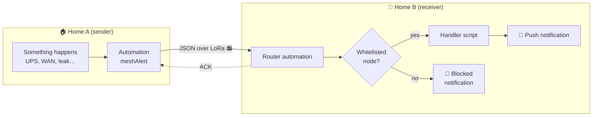

# 📡 ha-meshtastic-alerts

**Get Home Assistant alerts even when the internet is down.**

This package sends Home Assistant alerts (power, WAN, garage, alarm, leak, startup) over a
[Meshtastic](https://meshtastic.org) LoRa mesh to a second Home Assistant instance, which turns
them into normal push notifications and sends an ACK back. No cloud, no internet, no extra server.
Just two radios and two copies of this package.

It exists for the moment your usual notifications can't reach you, which is why "the WAN went
down" is one of the alerts it sends.



Every instance can be a sender *and* a receiver, so two homes (or a home and a cabin, or a
parent's place) can watch each other.

## Contents

- [What you need](#what-you-need)
- [Quick start](#quick-start)
- [Try it without a radio](#try-it-without-a-radio)
- [Sending your own alerts](#sending-your-own-alerts)
- [Troubleshooting](#troubleshooting)
- [Things that look like bugs but aren't](#things-that-look-like-bugs-but-arent)
- [What's in this repo](#whats-in-this-repo)
- [Contributing](#contributing)

## What you need

- **Two Home Assistant instances**, each with a Meshtastic node it can talk to (USB, Bluetooth or
  TCP). The two nodes need to reach each other over the mesh, directly or through other nodes.
- The **Meshtastic integration**,
  [meshtastic/home-assistant](https://github.com/meshtastic/home-assistant), on both instances
  (install it from HACS as a custom repository).
- A **shared channel**: the same channel name and PSK on both gateway nodes. Using a private
  channel rather than the default public one keeps your alerts off everyone else's screens.
- A working **notify action**. `notify.notify` works out of the box, or you can point it at a
  specific phone (see step 5 below).

## Quick start

Do these steps on **both** instances.

1. **Turn on packages**, if you haven't already. Add this to `configuration.yaml`:

   ```yaml
   homeassistant:
     packages: !include_dir_named packages
   ```

2. **Copy two files** into your config folder:

   | From this repo | To your Home Assistant |
   |---|---|
   | `packages/meshtastic_alerts.yaml` | `<config>/packages/meshtastic_alerts.yaml` |
   | `custom_templates/meshtastic_alerts.jinja` | `<config>/custom_templates/meshtastic_alerts.jinja` |

3. **Check and restart.** Go to *Developer tools → YAML → Check configuration*, then restart Home
   Assistant. The first time you add a package, a full restart is required (a reload isn't
   enough).

4. **Tell it which channel to use.** In *Settings → Devices & services → Helpers*, open
   **Meshtastic alert channel** and enter your shared channel's entity id, for example
   `meshtastic.<gateway>_channel_<name>`. You'll find it among the Meshtastic integration's
   entities.

5. **(Optional) Pick a phone.** Set **Meshtastic alert notify override** to a notify action such as
   `notify.mobile_app_your_phone`. Leave it empty to use `notify.notify`.

6. **Whitelist the other instance.** Only nodes on the whitelist can trigger alerts. The easiest
   way to get the peer's node number: let it send you anything once. You'll get a
   **🚫 Blocked Mesh Node** notification that shows its number. Add that number as an option on
   the `input_select.meshtastic_whitelist` helper.

   > 💡 Prefer YAML? Add it under `meshtastic_whitelist: options:` in the package file instead.

7. **Add some senders.** Copy what you need from [`examples/`](examples/) into your automations and
   swap out the `CHANGE_ME` entities. [`startup_alert.yaml`](examples/startup_alert.yaml) is a
   good first one: restart Home Assistant and the other side should get a push about a minute
   later.

That's it. 🎉

<details>
<summary>Not using packages?</summary>

You can paste everything into the UI editors instead:

- each item under `automation:` into a new automation (switch the editor to YAML mode),
- each key under `script:` into a new script **with the same id**,
- and create the helpers by hand, with the same ids as in the package file.

</details>

## Try it without a radio

You can test the receiving side before any hardware is involved. Go to
*Developer tools → Events*, fire a `meshtastic_api_text_message` event, and use a node number
that's on your whitelist:

```yaml
node: 123456789
data:
  message: '{"type": "garageAlert", "entity": "Test Door", "state": "open", "notify": "notify.notify", "retry": 0}'
```

| Try this | You should see |
|---|---|
| The event above | A **⚠️ Remote Garage Alert** push |
| A node number that isn't whitelisted | A **🚫 Blocked Mesh Node** notification |
| `"type": "bogus"` | A **📡 Remote HA Update** "Unrouted alert type" notification |

The trace for *Meshtastic: Dynamic Remote Alerts* should reach the ACK step. Without a real radio
the ACK itself may fail, and that's fine: it's allowed to.

## Sending your own alerts

Any automation can send an alert by adding one action. Always build the message with the
`meshAlert` macro so the format stays consistent:

```yaml
- action: meshtastic.broadcast_channel_message
  data:
    ack: true
    channel: "{{ states('input_text.meshtastic_alert_channel') }}"
    message: >-
      
      {{ meshAlert('leakAlert', 'Kitchen Sink', 'wet') | trim }}
```

Built-in alert types: `upsAlert`, `wanAlert`, `garageAlert`, `alarmAlert`, `leakAlert`,
`startupAlert`. Need a new one? It's a handler script plus one line in the routing table, with no
router changes. See [Adding an alert type](PROTOCOL.md#adding-an-alert-type).

> 📏 Keep entity names and states short. A LoRa message holds roughly 200 bytes of text.

## Troubleshooting

| Symptom | Likely cause |
|---|---|
| Nothing arrives at all | Check the two nodes can see each other in the Meshtastic app, and that both use the **same channel name and PSK**. |
| **🚫 Blocked Mesh Node** | The sender's node number isn't on this instance's whitelist. The notification tells you the number to add. |
| **📡 Unrouted alert type** | The receiver has no route for that `type`. Add the handler and the route on the receiving side. |
| **📡 check this route** | A route points at a script id that doesn't exist. Harmless if you just renamed the script, otherwise fix `input_select.meshtastic_routing`. |
| Sender's broadcast action errors | `input_text.meshtastic_alert_channel` is empty or holds the wrong entity id. |
| Push goes to every device, not your phone | The sender asked for a `notify` target that doesn't match your **notify override** helper, so it fell back to `notify.notify`. This is on purpose (see below). |
| Template error mentioning `meshtastic_alerts.jinja` | The `.jinja` file isn't in `<config>/custom_templates/`. Copy it, then run `homeassistant.reload_custom_templates`. |
| Startup alert never sends | The radio connects after Home Assistant starts. The example waits one minute. Increase the delay if your gateway is slow. |

ACKs are logged at info level: look for "Meshtastic ACK received" in *Settings → System → Logs*.

## Things that look like bugs but aren't

These are deliberate. Please don't "fix" them.

- **`continue_on_error` on dispatch and ACK.** A missing handler must never stop the ACK from
  going out.
- **The `ack` branch stops the run.** Without it, ACKs would get ACKed forever.
- **The two `input_select`s are lists, not pickers.** Their selected value means nothing. The
  router only reads their `options`.
- **No "does the script exist?" check before dispatch.** Dispatch uses storage keys while templates
  see entity ids, and the two drift apart when a script is renamed. The check after dispatch is
  advisory only.
- **The router passes `message` as a JSON string.** Home Assistant turns it back into a dict for the
  handler.
- **Handlers ignore the envelope's `notify` unless it matches local config.** A message from the
  mesh must never get to choose which Home Assistant action runs.

## What's in this repo

| Path | What it is |
|---|---|
| [`packages/meshtastic_alerts.yaml`](packages/meshtastic_alerts.yaml) | Helpers, the router automation, six handler scripts and the shared notify script |
| [`custom_templates/meshtastic_alerts.jinja`](custom_templates/meshtastic_alerts.jinja) | `meshAlert` (builds the message) and `getMeshtasticScript` (routing lookup) |
| [`examples/startup_alert.yaml`](examples/startup_alert.yaml) | Sends `startupAlert` when Home Assistant starts. A good end-to-end test |
| [`examples/wan_alerts_mesh.yaml`](examples/wan_alerts_mesh.yaml) | Sends `wanAlert` when the internet drops or returns |
| [`examples/broadcast_snippet.yaml`](examples/broadcast_snippet.yaml) | The single action any automation adds to send an alert |
| [`PROTOCOL.md`](PROTOCOL.md) | The message format, alert types, router logic and how to add a type |

### Optional extras

- Add `data: {url: /lovelace/<view>}` in `script.meshtastic_remote_notify` so tapping the push
  opens a dashboard (mobile app only).
- Want a push for ordinary chat messages too? A Meshtastic *device trigger* in the UI does that in
  a couple of clicks. It isn't included here because device triggers are tied to device ids.

## Contributing

Questions, bug reports and new alert types are all welcome. See
[CONTRIBUTING.md](CONTRIBUTING.md) to get started.
